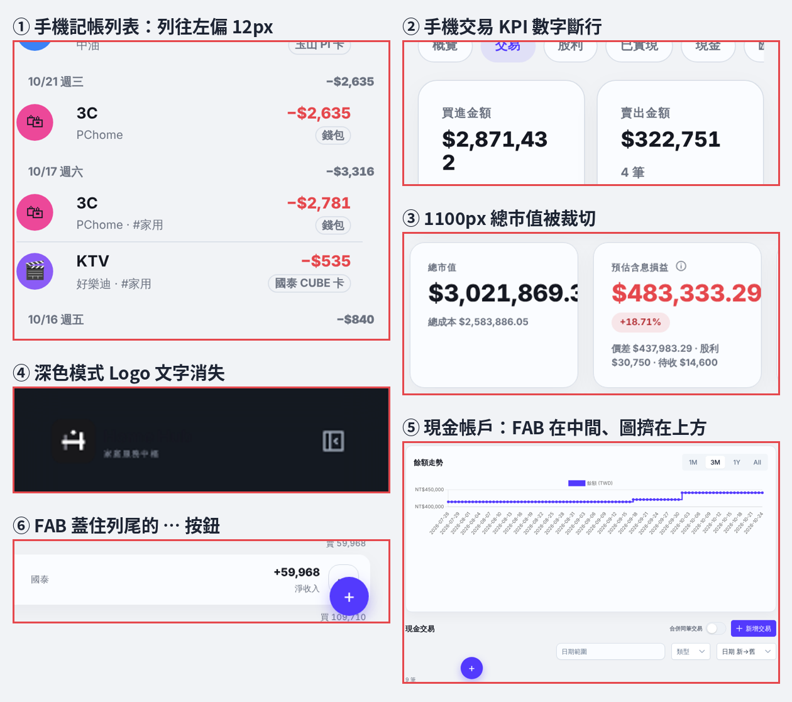

# Layout review · 2026-10-24

Run against `main` at #130 (`89d4440`) with seeded data: 6 holdings (5 TW, 1 US), 2 broker accounts, 8 dividends (2 pending), 5 accounting accounts, about 140 entries over Aug–Oct 2026. Every route screenshotted at 1440 × 900, 1100 × 800 and 390 × 844, light and dark. Quotes came from the seeded `price_history` (TWSE was not reachable from the sandbox). Specs: `openspec/changes/polish-layout-v2/`.

## Defects

| # | Where | What | Cause |
|---|---|---|---|
| 1 | 記帳時間軸 list mode (390 px), 帳戶 entry history | Rows start 4 px from the edge, 12 px left of the gutter | Bootstrap `.row` (`margin-inline: -12px`) applies to the component's own `.row` class |
| 2 | 交易紀錄 summary at 390 px | `$2,871,432` wraps after the last digit | Fixed font size, no fit rule |
| 3 | 投資概覽 KPI at 1100 px | `$3,021,869.34` clipped to `$3,021,869.3` | Same, plus two decimals |
| 4 | Sidebar, dark mode | Wordmark invisible | `logo-lockup.svg` has hard-coded dark fills |
| 5 | 現金帳戶 at ≥ 1024 px | 記一筆 button floats mid-page; sidebar always collapsed | Page writes `paneOpen`; FAB offset assumes accounting's 5fr / 6fr columns |
| 5b | 現金帳戶 balance chart | Plot uses a quarter of the card; rotated full dates; a dot per day; `#533afd` in dark | Chart options |
| 6 | 交易, 股利 at 1440 px | 記一筆 button covers row ⋯ buttons mid-scroll | FAB is fixed; no scroll behaviour |
| 7 | 淨值走勢 | Both lines drop to 0 on dates with cash activity but no trading | Cash-only snapshot rows (`total_market_value = 0`) plotted as-is |

## Layout and consistency

- Filters: three patterns (inline rows, titled card, nine wrapping controls). Phone filters take about 450 px before the first row.
- Empty right pane on 記帳 and 帳戶 at 1440 px (about 600 px wide) while the list column is cramped; 帳戶's empty copy says 選擇一筆記錄; the selected account is not marked.
- Phone headers wrap into two rows of actions (投資概覽 about 180 px).
- Phone 投資概覽: four full-width KPI cards (about 1,100 px); holdings rows five lines tall.
- Number formats differ for the same value across pages; one-decimal values appear (`$292,227.2`).
- 賣出成本費用 renders in the gain colour.
- Emoji in UI chrome on accounting pages (🔔, 💳, ✎ ⧉ ↺ 🗑); line icons elsewhere.
- Accounting puts the page title inside the list card; other groups put it on the background.
- 股利: 舊資料帳面 card shows `$0`, and an empty 即將除權息提醒 row renders.
- 匯入: 確認匯入 0 筆 footer shows before a file is chosen; native checkbox.

## Out of scope

Notification surfaces (提醒中心, the 🔔 count, toasts, reconciliation inbox cards) are handled in a separate change after the notification-center design is approved.
